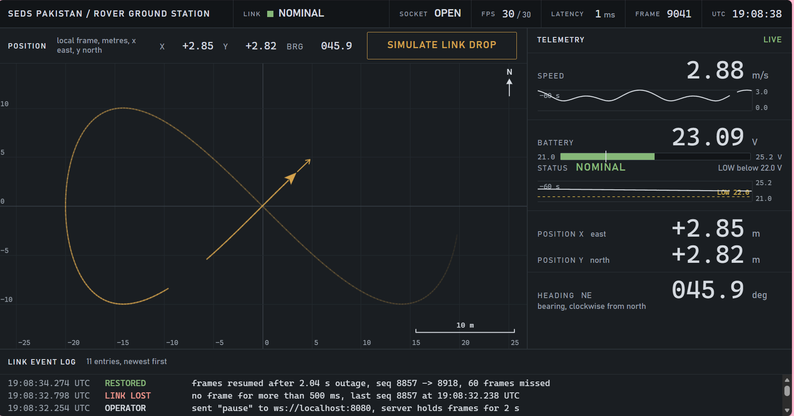
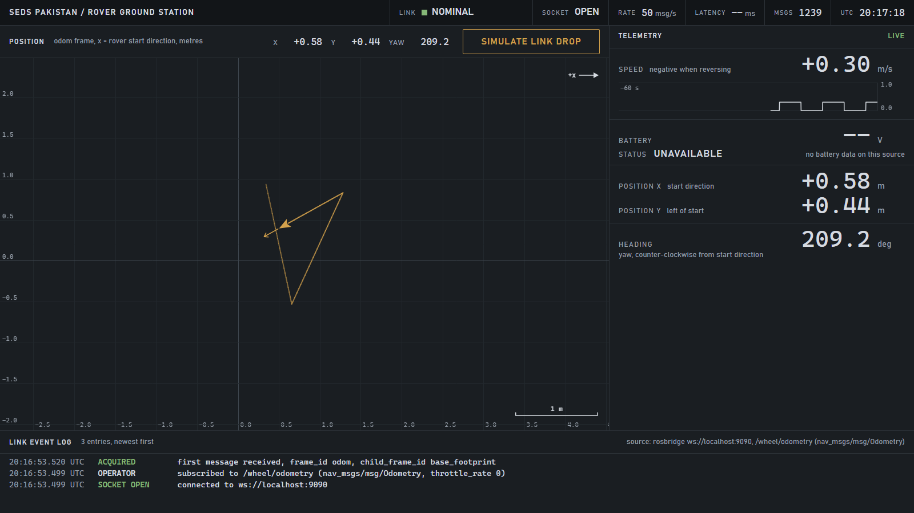

# SEDS Pakistan Rover Ground Station

A browser-based ground station telemetry dashboard for the SEDS Pakistan rover,
built for task **SEDS-TASK-ROV-SRILANKA-005** (Web Browser Ground Station
Telemetry Dashboard).

The dashboard receives telemetry over a WebSocket from one of two sources:

- **Simulator** (default): `server/telemetry-server.mjs`, a built-in simulator
  that sends speed, battery voltage, position and heading 30 times per second.
- **Rosbridge**: `nav_msgs/Odometry` from the `/wheel/odometry` topic, read
  through the rosbridge v2 WebSocket protocol, as published by the
  `wheel_odometry` node in the teammate repository `giyan-odometry`. For
  testing without ROS 2, `server/fake-rosbridge.mjs` replays that node's demo.

It shows:

- a top status bar with link state, socket state, measured rate, latency,
  frame or message counter and UTC clock
- a position map drawn on a canvas: grid in metres, scale bar, a north
  indicator (simulator) or a +x axis arrow (rosbridge), rover marker with
  heading arrow and a trail that fades with age
- a readout table for speed, battery voltage (with a NOMINAL / LOW status and a
  bar; shown as UNAVAILABLE in rosbridge mode), position X and Y, and heading
  (compass bearing in simulator mode, yaw in rosbridge mode)
- 60 second history traces for speed and battery voltage (battery trace hidden
  in rosbridge mode)
- a link event log with UTC timestamps
- a link watchdog that shows LINK LOST when data stops for more than 500 ms
  and recovers on its own when it resumes
- a "Simulate link drop" button for demonstrating the watchdog (works with the
  simulator and the fake rosbridge)

It uses Next.js (App Router), React and TypeScript in strict mode, plus the `ws`
package for the two servers. There are no UI libraries, chart libraries, map
tile services, external fonts, CDNs or API keys.





## Running it

Requirements: Node.js 20.9 or newer (required by Next.js 16; developed on Node 24) and npm.

```bash
npm install
```

### Simulator mode

In one terminal, start the telemetry simulator (WebSocket on port 8080):

```bash
npm run sim
```

In a second terminal, start the dashboard:

```bash
npm run dev
```

Open http://localhost:3000 (the same as http://localhost:3000/?source=sim).

### Rosbridge mode

In one terminal, start the fake rosbridge (WebSocket on port 9090):

```bash
npm run sim:rosbridge
```

In a second terminal, start the dashboard:

```bash
npm run dev
```

Open http://localhost:3000/?source=rosbridge.

With real ROS 2, the dashboard expects a rosbridge server on
`ws://localhost:9090` and the `wheel_odometry` node publishing
`/wheel/odometry`. This has not been tested (see Limitations).

### Scripts and settings

| Script | What it does |
|---|---|
| `npm run sim` | Telemetry simulator on port 8080 |
| `npm run sim:rosbridge` | Fake rosbridge on port 9090, publishing `/wheel/odometry` at 50 Hz |
| `npm run dev` | Dashboard development server on port 3000 |
| `npm run build` | Production build (includes the TypeScript check) |
| `npm run start` | Serves the production build |
| `npm run verify` | Runs the 9 acceptance checks described below |

Any `?source=` value other than `rosbridge` uses the simulator. Addresses can be
changed with environment variables set before `npm run dev` or `npm run build`:

| Variable | Default |
|---|---|
| `NEXT_PUBLIC_TELEMETRY_URL` | `ws://localhost:8080` (simulator mode) |
| `NEXT_PUBLIC_ROSBRIDGE_URL` | `ws://localhost:9090` (rosbridge mode) |
| `NEXT_PUBLIC_ODOM_TOPIC` | `/wheel/odometry` (rosbridge mode) |

Both servers take a `PORT` environment variable.

## Architecture

```
On the rover                                  In the browser
------------                                  --------------
updater.py (ROS 2 node)                       Next.js dashboard
  publishes std_msgs/String (JSON)              useTelemetry() hook
  on topic mission_control_updater   ---->      -> canvas map and traces
  at 100 Hz                         bridge      -> readout table, event log
                                  (WebSocket)

wheel_odometry (ROS 2 node, giyan-odometry)    Next.js dashboard, ?source=rosbridge
  publishes nav_msgs/Odometry                   subscribes with throttle_rate 0,
  on /wheel/odometry, one per         ---->     keeps every message, samples
  /joint_states (50 Hz in its demo) rosbridge   trail and traces at 30 Hz
                                    (port 9090)

In this repository
------------------
server/telemetry-server.mjs  --WebSocket, 30 Hz-->  dashboard, ?source=sim
(stands in for the rover and a bridge)
server/fake-rosbridge.mjs    --rosbridge, 50 Hz-->  dashboard, ?source=rosbridge
(stands in for wheel_odometry and rosbridge_server)
```

The reference rover software is `updater.py`, a ROS 2 node from the TrickFire
Robotics URC 2023 open-source code. It publishes a JSON string as a
`std_msgs/String` on the `mission_control_updater` topic every 10 ms (100 Hz).
On a real rover, a bridge (for example rosbridge, or a small rclpy node)
would subscribe to that topic and forward each message to the browser over
WebSocket. `updater.py` is part of the task materials and is not included in
this repository.

In this repository, `server/telemetry-server.mjs` plays the role of the rover
and the bridge together. It simulates the rover driving a figure-eight course
(40 m across, one lap per 60 s), with a battery that drains from 25.2 V to 21.0 V
over 10 minutes and then starts over. It sends one frame to every connected
client 30 times per second.

`server/fake-rosbridge.mjs` stands in for the `wheel_odometry` node and
`rosbridge_server`. It answers the rosbridge `subscribe` and `unsubscribe` ops
and publishes `nav_msgs/Odometry` on `/wheel/odometry` at 50 Hz, replaying the
node's demo: straight at 0.3 m/s for 5 s, then a turn on the spot at 0.5 rad/s
for 5 s, repeating. Messages use `frame_id` odom and `child_frame_id`
base_footprint, ROS 2 style header stamps, and the node's covariance values.
The first message after the server starts has zero pose and velocity, as in the
node. Unlike the real node, its velocities are exact, without timing jitter.

### Source layout

| Path | Contents |
|---|---|
| `server/telemetry-server.mjs` | Telemetry simulator (WebSocket server) |
| `server/fake-rosbridge.mjs` | Fake rosbridge publishing the odometry demo |
| `shared/telemetry-constants.mjs` | `WATCHDOG_MS`, `TARGET_FPS`, `PAUSE_MS`, `PAUSE_COMMAND`, default topic and rosbridge address, shared by the dashboard, servers and verify script |
| `shared/sample-gate.mjs` | Decides which messages become trail and trace samples (30 Hz in rosbridge mode); also used by the verify script |
| `shared/odometry.mjs` | `nav_msgs/Odometry` to x, y, yaw and speed; also used by the verify script |
| `lib/sources.ts` | The two sources: `?source=` handling, rosbridge subscribe, message decoding |
| `lib/odometry.ts` | Turns converted odometry into a dashboard frame |
| `lib/useTelemetry.ts` | WebSocket connection, reconnect with backoff, frame store, rate, latency, watchdog, event log |
| `lib/telemetry.ts` | Frame type and validation, heading to bearing conversion, number formatting |
| `lib/useCanvasLoop.ts` | requestAnimationFrame loop for a canvas sized to the device pixel ratio |
| `lib/drawMap.ts`, `lib/drawTrace.ts` | Canvas drawing for the map and the history traces |
| `components/` | Dashboard layout, status bar, readouts, event log, link drop button |
| `app/` | Next.js page, layout and stylesheet |
| `scripts/verify.mjs` | Acceptance checks |
| `proof/` | Saved output of `npm run verify` and dashboard screenshots |

## Data frame

### Simulator mode

Each WebSocket message is one JSON object:

```json
{ "seq": 1072, "ts": 1793124864189, "speed": 1.54, "batteryV": 24.95,
  "x": 13.589, "y": 9.971, "headingDeg": 5.97 }
```

| Field | Unit | Meaning |
|---|---|---|
| `seq` | count | Frame counter. It keeps counting while frames are held, so a gap in `seq` shows how many frames were missed. |
| `ts` | ms since the Unix epoch | Time the frame was created by the sender |
| `speed` | m/s | Ground speed |
| `batteryV` | V | Battery pack voltage. LOW below 22.0 V. |
| `x` | m | Position east of the start point |
| `y` | m | Position north of the start point |
| `headingDeg` | degrees | 0 = east (+x), increasing counter-clockwise, range 0 to 360 |

Frames that are not valid JSON or are missing a numeric field are ignored.

**Heading convention.** The frame uses the maths convention (0 = east,
counter-clockwise). The dashboard converts it to a compass bearing for
display: `bearing = (90 - headingDeg) mod 360`, so 0 = north and bearings
increase clockwise. The readout also shows the nearest 8-point cardinal
direction (N, NE, E and so on).

### Rosbridge mode

After it connects, the dashboard sends:

```json
{ "op": "subscribe", "id": "ground-station:/wheel/odometry",
  "topic": "/wheel/odometry", "type": "nav_msgs/msg/Odometry", "throttle_rate": 0 }
```

Each `{"op": "publish", "topic": "/wheel/odometry", "msg": {...}}` is converted
by `shared/odometry.mjs`:

| Dashboard value | From the `nav_msgs/Odometry` message |
|---|---|
| x, y (m) | `pose.pose.position.x`, `pose.pose.position.y` in the odom frame |
| yaw (deg) | `atan2(2*w*z, 1 - 2*z*z)` from `pose.pose.orientation`, normalised to 0 to 360 |
| speed (m/s) | `twist.twist.linear.x`, signed, negative when reversing |
| battery | not in the message: shown as UNAVAILABLE |
| sequence number | not in ROS 2 headers: frames missed after an outage are logged as unknown |

`{"op": "status"}` messages from the server, such as errors, are shown in the
event log as SERVER entries.

**Odom frame.** +x is the direction the rover faced when the odometry node
started, and +y is to its left. There is no north in this frame, so the map is
labelled "odom frame, x = rover start direction", shows a +x arrow instead of a
north arrow, and the heading readout is the yaw, counter-clockwise from the
start direction. The map view fits the visible trail, with a minimum span of
4 m.

**Latency.** ROS header stamps come from the ROS machine's clock, which is not
the browser's, so latency is shown as `--` in this mode. The rate in the status
bar is still measured from message arrival times.

## How the requirements are met

### 30 fps updates

- **Sending at 30 Hz.** `server/telemetry-server.mjs` sends at `TARGET_FPS`
  (30) from `shared/telemetry-constants.mjs`. It schedules each tick against
  the clock with `setTimeout` instead of using `setInterval`. On Windows,
  timers only fire about every 15.6 ms, so `setInterval(33.3)` gave about
  21 Hz; correcting each delay keeps the average at 30 Hz.
- **No React render per frame.** `lib/useTelemetry.ts` writes each frame into a
  mutable store (a React ref) instead of React state, so 30 frames per second
  do not cause 30 React renders per second.
- **Canvases redraw every animation frame.** The map and traces read that store
  through `lib/useCanvasLoop.ts`, drawn by `lib/drawMap.ts` and
  `lib/drawTrace.ts`.
- **Text readouts update at 10 Hz.** The readouts come from a throttled snapshot
  published 10 times per second.
- **Measured rate.** The status bar shows the measured frame rate, counted over a
  sliding 1 second window, next to the 30 fps target. Latency is
  `Date.now() - frame.ts` for the latest frame.
- **Rosbridge mode.** The subscription uses `throttle_rate` 0, so rosbridge
  forwards every message (a server-side throttle of 33 ms would turn a 50 Hz
  topic into 25 Hz). Every message updates the latest values; trail points and
  trace samples are recorded at 30 per second on average by
  `shared/sample-gate.mjs`. The display still redraws on every animation frame.
  The status bar shows the message rate in msg/s.

### 500 ms watchdog

- **Detection.** `lib/useTelemetry.ts` checks every 50 ms. If more than
  `WATCHDOG_MS` (500) has passed since the last frame, the link state becomes
  LINK LOST, so a loss is shown between 500 and 550 ms after the last frame.
- **While the link is lost.** The status bar, map and readout panel all say
  LINK LOST in text, and the values are held and dimmed. The event log records
  the time and the last sequence number received (in rosbridge mode, the time
  of the last message).
- **Recovery.** When frames resume, the state returns to NOMINAL on its own. The
  log records the outage length and how many frames were missed (from the
  `seq` gap; logged as unknown in rosbridge mode).
- **Connection handling.** If the WebSocket closes, the hook reconnects with
  exponential backoff: 0.5, 1, 2, 4, then 8 seconds between attempts.
- **Link drop button.** "Simulate link drop" sends `pause` to the simulator,
  or `{"op": "pause"}` to the fake rosbridge, which then holds data for
  `PAUSE_MS` (2 s). The button shows a countdown while the hold is active. The
  pause op is not part of the rosbridge protocol, so a real rosbridge is
  expected to reject it (not tested).

## Verification

```bash
npm run verify
```

`scripts/verify.mjs` checks the acceptance criteria "TypeScript build passing;
WebSocket updates at 30 fps with <500 ms watchdog" for the simulator, and the
odometry mode against the fake rosbridge. It uses a simulator on port 8080 and
a rosbridge on port 9090 if they are already running, otherwise it starts
`server/telemetry-server.mjs` and `server/fake-rosbridge.mjs` and stops them at
the end. Thresholds come from `shared/telemetry-constants.mjs`; checks 7 and 8
run the dashboard's own `shared/sample-gate.mjs` and `shared/odometry.mjs`.

| Check | Pass condition |
|---|---|
| 1. Simulator frame rate | 28 to 32 frames per second over 5 seconds |
| 2. Largest gap between simulator frames | under 100 ms |
| 3. Send `pause` to the simulator | a gap longer than `WATCHDOG_MS` (500 ms) is seen, then frames resume |
| 4. `npx tsc --noEmit` | exit code 0 |
| 5. `npm run build` | exit code 0 |
| 6. Odometry message rate | 45 to 55 messages per second over 12 seconds (50 Hz expected) |
| 7. Sample gate on the real arrival times | 28 to 32 samples per second |
| 8. Odometry conversion | straight phase: speed 0.30 +/- 0.01 m/s (each sample +/- 0.02), yaw spread at most 0.5 deg, direction of travel within 1 deg of yaw; turn phase: speed at most 0.01 m/s, yaw rate +28.65 deg/s +/- 5 % |
| 9. Send `{"op":"pause"}` to the rosbridge | a gap longer than `WATCHDOG_MS` is seen, then messages resume |

It prints one PASS/FAIL table with the measured values and the date and time,
saves the output to `proof/verify-output.txt`, and exits with a non-zero code
if any check fails.

Last saved run (`proof/verify-output.txt`, Windows 11, Node 24.18):

| Check | Measured | Result |
|---|---|---|
| 1. Simulator frame rate | 30.00 fps (150 frames in 5 s) | PASS |
| 2. Largest gap | 66.0 ms (mean 33.4 ms, p99 49.0 ms) | PASS |
| 3. Simulator pause | 2031 ms outage, frames resumed, 60 frames missed | PASS |
| 4. TypeScript check | exit 0 | PASS |
| 5. Production build | exit 0 | PASS |
| 6. Odometry message rate | 50.00 msg/s (600 in 12 s) | PASS |
| 7. Sample gate | 29.87 samples/s (359 of 600 kept) | PASS |
| 8. Odometry conversion | straight +0.300 m/s, yaw spread 0.00 deg; turn yaw rate +28.64 deg/s | PASS |
| 9. Rosbridge pause | 2008 ms outage, messages resumed | PASS |

The simulator's largest gap varies between runs: 48.7 ms in the run just before
(`proof/verify-output-run1.txt`) and 66.0 ms in the saved run, because of the
Windows timer resolution (about 15.6 ms) and other load on the machine. All 9
checks passed in both runs. It is the check with the smallest margin. Check 8
measures exact values because the fake rosbridge computes ideal odometry; the
real node's speeds jitter slightly around 0.3 m/s.

## Limitations

- **Rosbridge mode tested only against the fake.** Rosbridge mode was tested
  only against `server/fake-rosbridge.mjs`, which replays the `wheel_odometry`
  demo pattern. It has not been run against a real `rosbridge_server`, ROS 2,
  or the actual `wheel_odometry` node, and the fake does not reproduce the real
  node's speed jitter.
- **Simulated telemetry.** Both data sources used in testing are simulated. The
  dashboard has not been connected to the rover.
- **No bridge for updater.py.** Forwarding the `mission_control_updater` topic
  to the browser has not been built or tested.
- **Different message content.** The JSON that `updater.py` publishes holds motor
  state entries (built by `InfoToJSONHelper` from the motor configuration), not
  the position, speed, battery and heading fields used here. A bridge, or a
  change on the rover side, would need to produce this frame format, or the
  dashboard would need to be adapted to the real message.
- **Different rates.** `updater.py` publishes at 100 Hz, while the dashboard is
  designed and tested for 30 Hz. A bridge would need to downsample, or the
  dashboard would need checking at the higher rate.
- **Battery unavailable in rosbridge mode.** `nav_msgs/Odometry` carries no
  battery data, so the battery readout shows UNAVAILABLE and its trace is
  hidden.
- **Link drop button needs a simulator.** The pause it sends is understood only
  by `server/telemetry-server.mjs` and `server/fake-rosbridge.mjs`. A real
  rosbridge is expected to answer with an error status; in that case the code
  clears the button after about 3 s without a link drop. This has not been
  tested with a real rosbridge.
- **Local position frame.** Position is in a local frame in metres starting at
  the origin (in rosbridge mode, the odom frame, where +x is the rover's start
  direction). There is no GPS or map projection.
- **No security.** There is no authentication or encryption on the WebSocket
  (`ws://`, not `wss://`). It is meant for a trusted local network.
- **Pause affects everyone.** The pause is a demonstration feature of the two
  simulators. It affects every connected client.
- **Limited test coverage.** `npm run verify` checks the data sources' rates and
  timing, the sample gate, the odometry conversion and the build. It does not
  drive the dashboard in a browser. The dashboard's LINK LOST display and
  recovery were checked by hand in the browser with the link drop button, in
  both modes.
